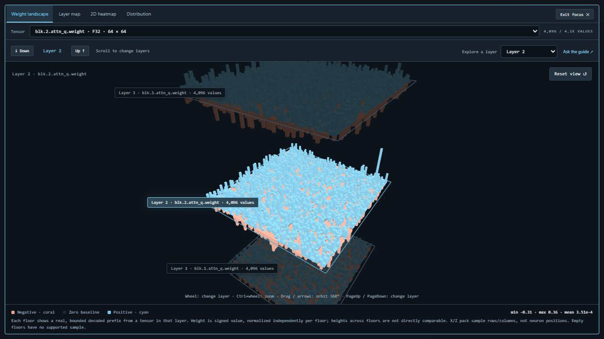
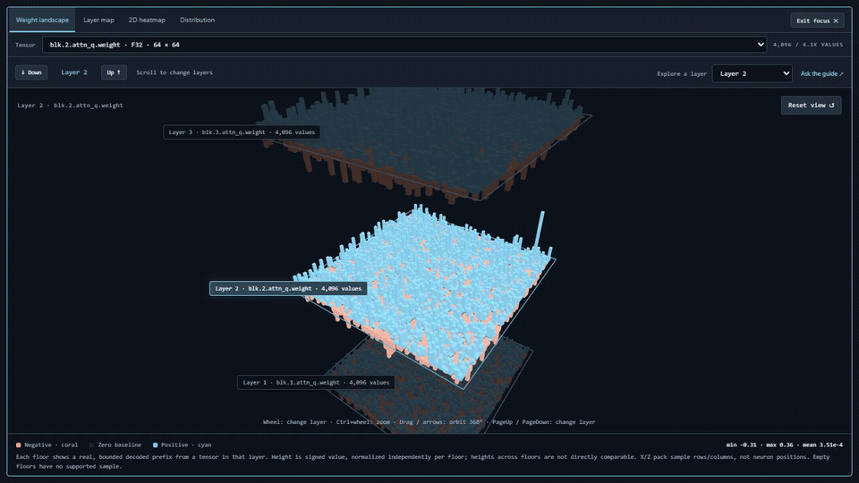
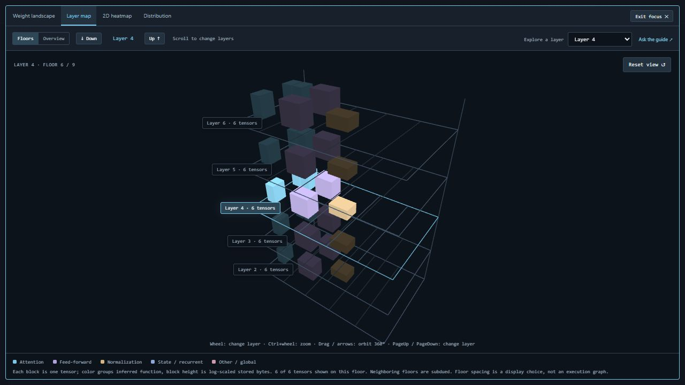
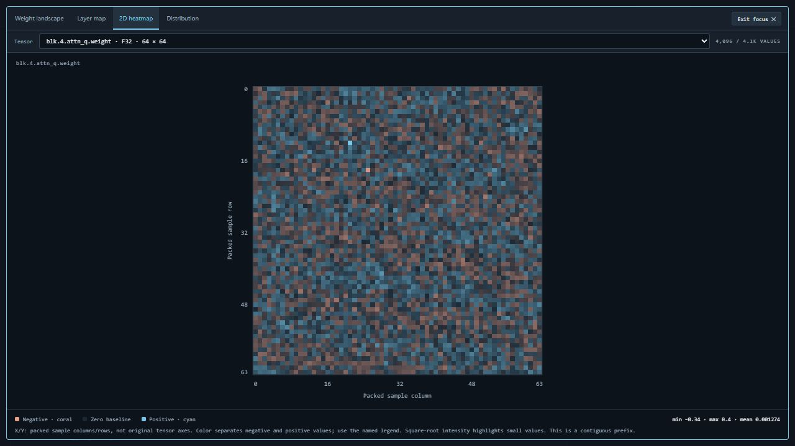
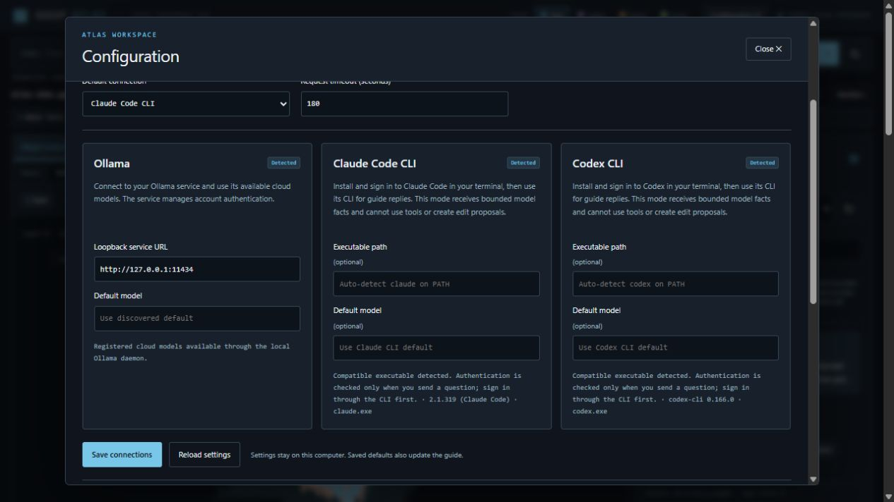
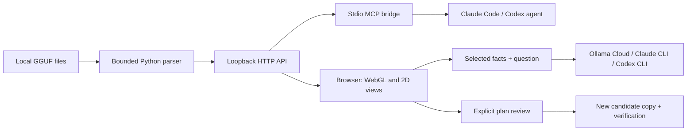

<div align="center">

# GGUF Atlas

### Look inside your model.

A local visual workbench for GGUF structure, sampled weights, and agent-assisted exploration.

[](https://github.com/llmxlabs/gguf-atlas/actions/workflows/ci.yml)
[](LICENSE)
[](pyproject.toml)

[Quick start](#quick-start) · [User guide](docs/user-guide.md) · [Connect your AI](docs/configuration.md) · [Architecture](docs/architecture.md)

</div>



Explore a model as a stack of layers, orbit around signed weight landscapes, compare a heatmap with its distribution, and ask a guide what the selected evidence means. Atlas reads your existing GGUF files locally. You can inspect a large model without loading it for inference.

## Explore from more than one angle



*Recorded in the application using the included synthetic demo. These are generated fixture weights, not activations or trained model behavior. [Download the MP4 tour](docs/media/atlas-tour.mp4).*

| Weight landscape | Layer floors |
| --- | --- |
| Full 360° orbit around positive and negative sampled values. Scroll through layers; Ctrl+scroll zooms. | Each floor contains tensor blocks grouped by inferred function. Switch to Overview for storage aggregates. |

| Layer map | Packed sample heatmap |
| --- | --- |
|  |  |

Four themes—**Slate, Indigo, Ember, Forest**—update the entire interface and plot legends. Tensor search, precision summaries, metadata previews, exact offsets and manifest export provide the numbers behind the pictures.

## Quick start

You need **Python 3.11+**, Git, and a modern browser. No CUDA toolkit, frontend build or third-party Python runtime packages are required. WebGL enables the 3D views. A chat provider is optional.

```sh
git clone https://github.com/llmxlabs/gguf-atlas.git
cd gguf-atlas
python -m venv .venv
```

Activate the environment:

```powershell
# Windows PowerShell
.venv\Scripts\Activate.ps1
```

```sh
# macOS / Linux
source .venv/bin/activate
```

Install and run the reproducible demo:

```sh
python -m pip install .
python examples/create_demo.py --output demo/atlas-demo.gguf
gguf-atlas --root demo
```

Open **[http://127.0.0.1:18040](http://127.0.0.1:18040)**. The demo creates a new file under 1 MB and refuses to overwrite an existing file. It is a visualization fixture, not a runnable LLM. To use existing weights instead:

```sh
gguf-atlas --root /path/to/models
```

Windows example: `gguf-atlas --root "D:\Models"`. Repeat `--root` for multiple folders. Stop the foreground server with Ctrl+C. `python -m viewer.server` is an equivalent entry point. Run `gguf-atlas --help` for output-directory, configuration and port options. Windows source-checkout shortcuts are also included.

## Bring your own assistant

Open **Configuration** in the header. Choose your in-app guide, or copy MCP setup for an external agent session.



| Connection | What it does |
| --- | --- |
| **Ollama Cloud** | Uses a signed-in local Ollama daemon. The guide can request bounded inspection tools and prepare reviewable edit plans. |
| **Claude CLI / Claude Code** | Uses an installed, authenticated CLI for in-app explanations of a bounded selection snapshot. |
| **Codex CLI** | Uses an installed, authenticated CLI for the same snapshot-based in-app chat. |
| **External Claude Code or Codex via MCP** | Lets your agent list models, inspect tensors, sample values and propose edits through Atlas tools. |

Inspection works without a provider. Atlas does not bundle subscriptions or collect provider passwords. A provider question sends bounded context to the selected provider and may consume your account's quota. CLI snapshot chat does not autonomously browse tensors; use the MCP connection for agent-driven inspection. [Setup, permissions and data flow →](docs/configuration.md)

## How it works



The parser indexes metadata and tensor directories. Supported encodings expose a bounded prefix of decoded values—up to 4,096 per displayed tensor sample. The browser renders those samples and inferred structural groups. No model inference is required, and no full GGUF is uploaded by the in-app guide.

Experimental editing supports **F32, F16 and BF16 scale/zero operations** on a selected range. An assistant can propose a plan; applying one requires an explicit browser action. Atlas hashes the source, creates a separate candidate, verifies the intended byte changes and writes a manifest. [Experiment workflow and limits →](docs/experiments.md)

## Know what you are looking at

- Layer colors and roles are inferred from tensor names; the map is not a recovered execution graph.
- Landscape positions pack sample indices; they are not neuron coordinates. Heights normalize independently on each floor.
- Sample statistics describe a contiguous prefix, not the whole tensor. Some quantized types are directory-only.
- A byte-valid edited candidate is not evidence of model quality. Quantized editing, semantic capability edits and automated evaluation are not implemented.
- Atlas binds to loopback and is intended for a trusted local machine. It is not a hosted multi-user service.

See [visualization semantics](docs/visualizations.md) and [architecture boundaries](docs/architecture.md).

## Documentation and development

| Guide | Contents |
| --- | --- |
| [User guide](docs/user-guide.md) | Start, select, navigate, inspect, chat and review |
| [Visualizations](docs/visualizations.md) | Controls, colors, scales, samples and interpretation |
| [Configuration](docs/configuration.md) | Providers, CLI detection, MCP clients and privacy |
| [Architecture](docs/architecture.md) | Modules, data flow, storage and bounded work |
| [HTTP API](docs/api.md) | Endpoints, request fields, errors and integration |
| [Experiments](docs/experiments.md) | Plans, candidate copies, verification and limitations |
| [Testing](docs/testing.md) | Automated checks, manual verification and troubleshooting |

Contributions are welcome. Read [CONTRIBUTING.md](CONTRIBUTING.md) for local checks and PR expectations. Tests use synthetic fixtures; CI does not download models or make paid provider calls. This is an early workbench: expect the API and supported encodings to evolve.

MIT licensed. See [third-party notices](THIRD_PARTY_NOTICES.md) for GGUF/llama.cpp references and visual inspiration.
