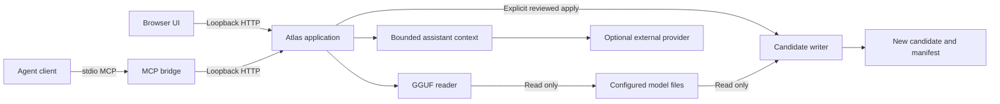

# Architecture and boundaries

[Project home](../README.md) · [User guide](user-guide.md) · [Configuration](configuration.md) · [HTTP API](api.md)

GGUF Atlas is a local workbench with a Python inspection engine, a browser interface, optional assistant providers, and a stdio MCP bridge. Inspecting a model does not run inference. The browser renders a bounded representation of file structure and sampled values.

## Components

| Component | Responsibility | Source |
| --- | --- | --- |
| GGUF reader | Validate metadata and tensor-directory structure; compute storage totals; decode supported bounded samples | [gguf_core.py](../viewer/gguf_core.py) |
| HTTP application | Catalog scoped files, cache inspections, serve UI/API, retain plans/jobs, coordinate provider requests | [server.py](../viewer/server.py) |
| Candidate writer | Bind a plan to source identity/hash; create and verify a separate full-file candidate | [experiments.py](../viewer/experiments.py) |
| Assistant integration | Build compact context, call optional providers, constrain Ollama inspection/proposal tools | [assistant.py](../viewer/assistant.py) |
| CLI snapshot adapters | Invoke compatible installed Claude Code/Codex CLIs with bounded input/output and restricted answer-only operation | [cli_assistant.py](../viewer/cli_assistant.py) |
| User settings | Portable storage defaults, validated provider configuration, CLI discovery, and generated MCP snippets | [configuration.py](../viewer/configuration.py) |
| MCP bridge | Present typed inspection/proposal tools to a compatible local agent client | [mcp_server.py](../viewer/mcp_server.py) |
| Browser state | Model selection, tables, metadata, palettes, guide and experiment controls | [app.js](../viewer/static/app.js), [guide.js](../viewer/static/guide.js) |
| Renderer | Local WebGL geometry, orbit, picking and redraw | [topology.js](../viewer/static/topology.js) |

Python 3.11+ and its standard library provide the application runtime. The frontend uses local HTML/CSS/JavaScript assets; there is no frontend build or CDN dependency. Node is a development test tool, not the production server. Optional provider CLIs and Ollama are separate installations. See [Configuration](configuration.md) for paths, provider availability, and launch settings.

Provider settings live in a per-user JSON file rather than the installed package. `--config` or `GGUF_ATLAS_CONFIG` can select another file. Repeated `--root` options select model directories; `--experiment-root` and `--log-root` select writable output locations. Settings updates are validated and written through a temporary file plus atomic replacement. Configuration stores provider/model identifiers and executable locations, not account credentials.

## Inspection pipeline

1. Scan configured roots for `.gguf` files. Return catalog IDs, names, paths, and sizes to the local client. An ID identifies a catalog path; it is not a content hash.
2. Open a selected file for reading. Parse the header, bounded metadata previews, and tensor directory without reading all tensor payloads.
3. Validate counts, lengths, dimensions, alignment, known encoded sizes, and file ranges. Derive aggregate counts and infer tensor roles/layers from names.
4. Cache up to three inspection reports using path identity, byte length, and modification time. Check file stats around an inspection or sample to detect ordinary concurrent changes.
5. Read tensor payload only when a sample is requested. Decode a contiguous prefix of at most 4,096 values through the HTTP API; report unsupported formats explicitly.

Stat-based cache identity is useful for interactive performance, but is not cryptographic provenance. Experiment plans additionally hash the complete source. Files being replaced or modified concurrently should be allowed to stabilize before inspection.

The parser accepts GGUF versions 2 and 3, including version 3 big-endian directory/scalar handling. Packed big-endian sampling is unsupported. It recognizes more encoding sizes than it can decode. An unknown size remains `null`, with a warning; padding is not silently treated as known tensor payload. A split shard can be inspected, but its totals describe that file alone.

Defensive parser bounds include a 256 MiB header-position limit, a 16 MiB retained-string budget, an eight-million metadata item budget, and a maximum of 200,000 tensor entries. These are application limits, not claims about everything the GGUF specification permits. Malformed or unusually large inputs can be refused rather than exhausting memory.

Metadata arrays longer than 16 elements become count/preview objects. Long strings also have explicit preview markers. Those reports are inspection artifacts, not lossless inputs to a converter or metadata editor.

## What the numbers and graphics establish

`parameter_count` is the sum of stored tensor elements, including auxiliary tensors. It does not necessarily equal the marketed model count, the number of unique trained parameters, or the active MoE parameters per token. Encoded tensor bytes exclude metadata and alignment padding and do not predict inference VRAM requirements.

The architecture map groups tensors using names and metadata. It is a structural index, not a recovered executable graph. It does not identify every operation, residual edge, expert route, or runtime optimization. Unknown roles remain inspectable rather than being assigned invented semantics.

Samples are deterministic prefixes. Histograms and statistics cover finite values in that prefix, not the entire tensor. Display rows pack at most 64 values; they are not the original axes or spatial neuron positions. Landscape floors normalize their heights independently, so equal plotted heights on different floors need not mean equal absolute values. [Visualizations](visualizations.md) defines the available views and controls.

Python performs parsing, statistics, hashing, and transformations on the CPU. WebGL can use the browser's graphics backend to render geometry; this is not GPU inference or GPU numerical analysis of the full model. No visualization alone establishes a weight's causal meaning or a model's quality.

## Assistant and agent separation

The inspected GGUF is data; an optional assistant provider answers questions about that data. Selecting a local GGUF does not select or load it as the chat provider.

Built-in chat prepares compact model and selection facts. Provider modes have different capabilities: Ollama Cloud can use a bounded inspection/proposal tool loop, while supported CLI chat modes receive a read-only snapshot. Snapshot chat is not an MCP agent session. A separately configured agent client can use the MCP bridge's tools directly. See [Configuration](configuration.md) for the supported provider modes and [API](api.md) for request details.

Built-in cloud context excludes automatic file paths, tokenizer arrays, embedded chat templates, and full model payloads. Ollama tool samples can include statistics and up to 16 example values. MCP results are more detailed: the calling client may receive local paths, metadata previews, exact tensor records, and up to 4,096 sampled values. The client determines how those results enter its provider context. Treat either channel's model strings and generated answers as untrusted data.

CLI snapshot adapters add a bounded sample summary and up to 16 example values when a tensor is selected. They pass the snapshot through stdin, without a shell, from a temporary empty working directory. Supported command flags restrict tools, project/user-context discovery, persistence, and approvals; the adapter rejects CLI versions missing its required controls. Combined stdout/stderr is bounded, and timeout/output-limit handling terminates the owned process tree. These restrictions depend on the installed CLI honoring its options; they are not an operating-system sandbox for arbitrary executables. Atlas does not read or manage the CLI's credentials, and provider/account charges may apply.

## Experiment lifecycle

Planning validates the source and exact edit range, computes its SHA256, and creates an in-memory review plan. Applying requires the retained plan ID and explicit confirmation. The writer streams a separate whole-file candidate, verifies source identity and hash, checks structure, and compares every candidate byte with the expected transformation before publication.

There is one concurrent planning slot and one concurrent candidate-writing slot. Plans and jobs are session-scoped, with bounded retained histories. A successfully completed candidate is ready for evaluation; Atlas does not automatically load it, benchmark its behavior, or switch an inference service. [Experiments](experiments.md) describes supported edits, filesystem requirements, and recovery limits.

## Local trust boundary

The HTTP server binds to IPv4 loopback. It validates Host and supplied Origin, rejects cross-site fetch metadata, serves a static allowlist, and does not enable CORS. Model access uses catalog IDs and resolved-root checks. MCP connects only to an explicit loopback backend, disables proxies, and rejects redirects.

There is no login, TLS endpoint, multi-user authorization system, or hard isolation from other programs running as your user. The browser's apply handoff is an explicit product review step, not a security boundary against arbitrary local code. Do not expose this server through a public proxy or tunnel as though it were a hardened hosted application.

Atlas's tool lists contain no shell-execution or arbitrary-file-read tool. Assistant/MCP proposal tools cannot apply an edit. Ordinary HTTP clients on the same machine can call documented APIs, including the explicit apply operation; keep that distinction clear when integrating agents.

## Format provenance and extension points

The parser follows the [GGUF specification](https://github.com/ggml-org/ggml/blob/master/docs/gguf.md). Encoding definitions and numerical behavior were cross-checked against llama.cpp's [constants](https://github.com/ggml-org/llama.cpp/blob/80d2c0c2c56e4a1bbf74be98f64b99927bf230bc/gguf-py/gguf/constants.py) and [quantization implementation](https://github.com/ggml-org/llama.cpp/blob/80d2c0c2c56e4a1bbf74be98f64b99927bf230bc/gguf-py/gguf/quants.py) at that pinned revision. Consult the repository license/third-party notices for attribution. Upstream support does not imply Atlas supports every encoding or runtime architecture.

Useful extensions include additional independently verified decoders, richer comparison views, and provider adapters that preserve bounded context and explicit edit review. Packed quantized writing, metadata/architecture surgery, automated inference evaluation, and native desktop packaging are not implemented features. New work should retain the distinctions between observed file facts, visual interpretation, and experimentally verified behavior.
