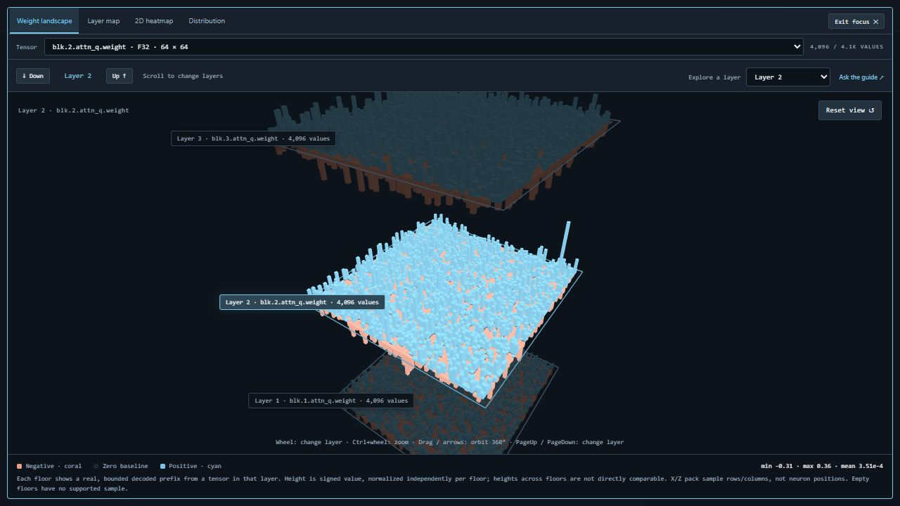
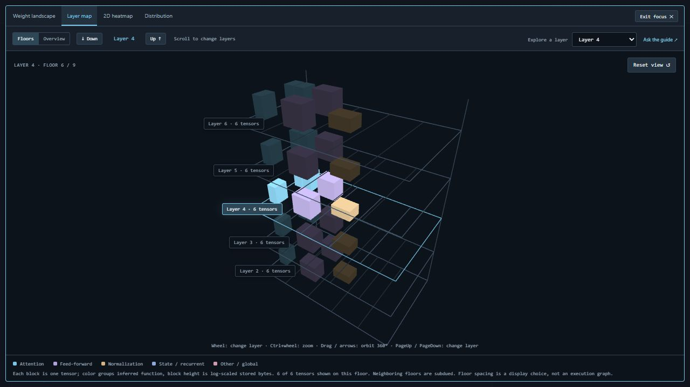
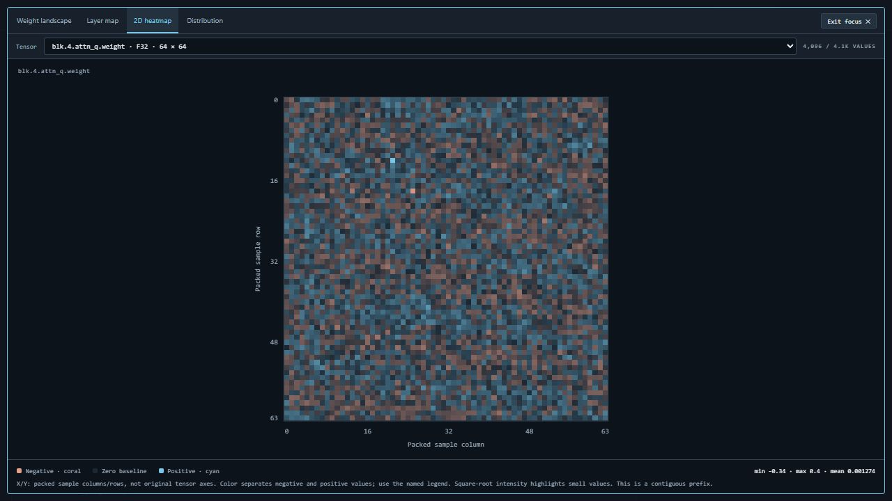

# What the visualizations mean

[Home](../README.md) · [User guide](user-guide.md) · [Architecture](architecture.md)

Atlas visualizes two kinds of evidence: file structure and decoded sample values. None of these views runs the model or displays prompt activations.

## Weight landscape

Each narrow bar is one decoded scalar from a bounded contiguous tensor prefix. Positive values rise above the floor's zero plane and negative values extend below it. Drag underneath to inspect either sign. X/Z positions pack values into 64 display columns; these coordinates are neither original tensor axes nor recovered neuron positions.

The active floor and immediate neighbors use real named samples from their respective layers, at most 4,096 values per floor. A neighboring layer with no supported sample stays explicit. Atlas does not substitute a different layer's values to fill a gap. A five-entry cache and at most two neighboring sample requests bound carousel work.

**Every floor normalizes height independently.** Equal visible heights on two floors need not mean equal numeric values. Compare the reported statistics or hover values. A sampled prefix cannot establish whole-tensor distributions, sparsity or outliers elsewhere in the tensor.

## Layer map

Floors shows the selected layer and up to two neighbors on each side. Global tensors occupy their own floor. Each block represents one tensor, colored by an inferred function: attention, feed-forward, normalization, state/recurrent, or other/global. Height is log-scaled stored bytes. Large encoded storage is not proof of greater semantic importance.

The floor view caps drawing at 256 blocks per floor and reports shown/total counts. The directory remains available for all entries. Sparse layer IDs use sorted ordinal navigation. Vertical spacing is a navigation device, not measured neural distance.

Overview aggregates by layer and inferred function, with a bounded set of displayed layer groups. Neither layout reconstructs execution edges, routing decisions or activation paths. Tensor names drive the role heuristic; architecture-specific names can fall into other/global.

## Heatmap and distribution

The heatmap packs the same bounded prefix into display rows and columns. Color expresses sign and magnitude; a separate warning color marks nonfinite values. A pattern in packed storage order may not correspond to the model's semantic axes. Hover to read the sample index and numeric value.

Distribution counts finite values in sample bins. Horizontal position is decoded value, vertical position is sample count. A bin crossing zero uses a secondary color. Bin counts and extremes describe the sampled prefix only. NaN and infinity are handled separately rather than silently counted as finite data.

## Themes, controls and performance

Slate, Indigo, Ember and Forest change palettes without changing weights, sample selection or camera orientation. Legends name both signs and colors. The [user guide](user-guide.md#choose-a-palette) lists each mapping.

| Input | Carousel behavior |
| --- | --- |
| Wheel | Move up/down layers |
| Ctrl + wheel | Zoom |
| Drag / arrow keys | Full 360-degree orbit |
| PageUp / PageDown | Change layer |
| + / - | Zoom |
| Home / Reset view | Restore camera |

Overview and the small tensor inspector use ordinary wheel zoom. Keyboard actions apply when the relevant canvas has focus. Named buttons and dropdowns provide alternatives to wheel gestures.

The browser uses WebGL for 3D rendering and Canvas 2D for heatmaps/charts. Python decodes only bounded samples on CPU. Atlas does not need to reserve enough VRAM for the inspected model, and it does not launch an inference server. There is no claim of GPU tensor analysis or comparative Rust/Tauri speed.

All repository gallery images and animation use the deterministic synthetic demo, not a trained model or measured model behavior.
